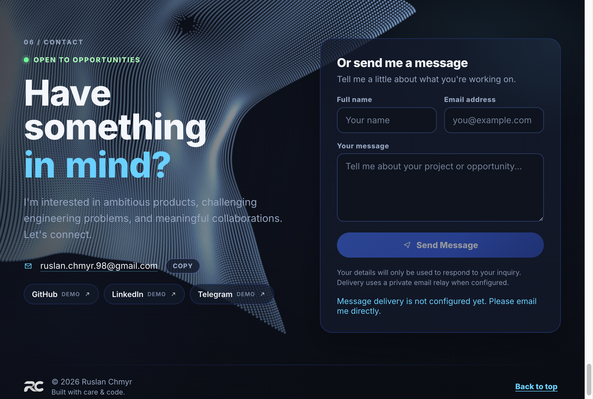

# RC — Interactive Developer Portfolio

A personal portfolio built as an interactive experience rather than a traditional set of pages. Motion, 3D visuals, and carefully paced scroll storytelling introduce the work and engineering background behind the site.

**React · TypeScript · Three.js · WebGL · GSAP · Vite**

> Live demo URL is not published in this repository yet. Run locally with the commands below.

### Project preview

Contact section particle fabric (repository screenshot):



---

## The Experience

What a visitor meets, section by section.

### Interactive introduction

The site opens on an **RC** monogram that responds to the cursor. As you scroll, the mark dissolves through an ink-like transition and hands control over to the rest of the portfolio.

### About

Large typography unfolds into a personal introduction — portrait, short bio, and a clear sense of focus — before the page continues downward.

### Skills

An interactive **3D keyboard** lets visitors explore technologies and engineering themes. Selecting keys opens inspection details; engineering stories can highlight related skills and flip the board between categories.

### Projects

A selected set of projects is presented in a pinned, scroll-driven sequence that transitions from Skills into the next chapter of the page.

### Experience

A scroll-synced career timeline highlights milestones as you move, with a sticky year rail and an invitation to view the full CV when a PDF link is configured.

### Contact

An animated particle fabric sits behind contact options, social links, and a message form — with a readable CSS fallback if WebGL cannot run.

---

## Engineering Highlights

Concrete systems that make the experience hold up under scroll, load, and device constraints.

### Custom WebGL fluid simulation

The intro mark is driven by a **WebGL2** fluid-style simulation with GLSL programs, float render targets, and pointer-driven forces. Scroll progress drives an ink transition (distance-field capture + shaders). When WebGL2 or required extensions are unavailable, the intro falls back to SVG presentation. Runtime dispose cleans GPU resources when the intro lifecycle ends.

### Interactive 3D Skills keyboard

Built with **React Three Fiber**, **Three.js**, and **Drei**: key geometry, lighting, contact shadows, category flip animations, Story Focus highlighting, and React-owned selection state. Rendering uses a **demand / never** frameloop so idle or offscreen scenes stay quiet. A static keyboard fallback remains interactive when WebGL is unavailable or while the 3D module is still loading.

Heavy Three/R3F code is **not** pulled on first paint. An IntersectionObserver gate loads the Skills canvas chunk only as the section approaches the viewport, then keeps the canvas mounted for the session.

### Scroll-driven storytelling

**GSAP** and **ScrollTrigger** pin and scrub About, Skills handoff, Projects, Experience, and Contact entrances. Controllers own dispose, reduced-motion paths, and reverse-friendly scrubbing. A shared `scheduleScrollTriggerRefresh` coalesces layout refreshes so sections do not thrash `ScrollTrigger.refresh()` independently.

### Custom particle fabric (Contact)

Contact uses an original Three.js **Points** mesh with custom vertex/fragment shaders — fold motion, depth, and a soft pointer brush. Density and DPR adapt by viewport; initialization is viewport-triggered; the loop pauses offscreen; context loss falls back to CSS. This is a project-owned approximation, not the license-gated React Bits Pro Spectral Drape component. The heading uses a lightweight “Gravity Letters” fallback for the same reason.

### Contact delivery infrastructure

`POST /api/contact` is a **Vercel serverless** handler that validates input, enforces size limits, applies a soft per-isolate rate limit, and calls **Resend** with a timeout. Success means `{ ok: true }` — acceptance by the provider, not guaranteed inbox delivery. Without server credentials the API returns an honest unavailable response. Production should also enable platform WAF rate limiting on the route.

---

## Performance Optimization — Before & After

Laboratory Lighthouse runs against **production Vite builds** (simulated throttling). Scores are lab metrics, not CrUX / real-user field data.

| Metric | Before | After |
| --- | ---: | ---: |
| Desktop Performance | 97 | **100** |
| Mobile Performance | 70 | **95** |
| Approx. initial transfer | ~2.56 MB | **~251 KB** |
| Mobile FCP | 3.9s | **2.1s** |
| Mobile LCP | 5.6s | **2.6s** |
| CLS | 0 | **0** |

Mobile LCP measured **2.6s** in lab — improved, but not claimed as meeting a 2.5s Core Web Vitals threshold.

Initial load dropped sharply **without removing** the 3D keyboard or other approved effects. Heavy graphics load when the visitor approaches the relevant section; images, fonts, and audio follow the same pay-when-needed approach. Runtime work also includes ScrollTrigger refresh coalescing, Contact particle budgets / offscreen pause, WebGL context-loss fallbacks, and intro GPU cleanup.

### How it was measured

- `npm run build` + `vite preview`
- Lighthouse (desktop preset / mobile form-factor, simulated throttling)
- Network panel / Performance resource timing for chunk attribution
- Chrome DevTools Protocol checks for Canvas init timing where used

---

## Architecture & Technical Decisions

```text
src/
├── app/                 # Portfolio shell, nav, chrome
├── features/
│   ├── intro/           # WebGL2 fluid + ink transition
│   ├── about/           # Typography timeline + portrait
│   ├── skills/          # R3F keyboard, stories, load gate
│   ├── projects/        # Pinned scrub showcase
│   ├── experience/      # Career timeline + CV CTA
│   └── contact/         # Fabric, form, links, entrance
├── shared/
│   ├── graphics/        # Fluid simulation core
│   ├── scene/           # ScrollTrigger refresh coordination
│   ├── pointer/         # Shared pointer helpers / cursor bridge
│   ├── theme/           # Theme + self-hosted fonts
│   └── lib/webgl/       # Low-level WebGL helpers
api/
└── contact.ts           # Vercel Function (Resend)
```

**Feature-based ownership** — each section keeps UI, hooks, config, controllers, and tests together.

**Clear runtimes** — React owns structure and state; GSAP controllers own pins/timelines and dispose; WebGL modules own init, pause, and cleanup.

**Progressive enhancement** — Skills fallback, Contact CSS fabric, intro SVG path, and reduced-motion branches keep the page usable when GPU or motion is limited.

**Performance boundaries** — Skills Three/R3F and Contact fabric load near viewport; audio and large images follow the same “pay when needed” idea.

---

## Quality & Accessibility

- TypeScript throughout (`tsc -b` in production build)
- Vitest suite — **234** tests passing at README rewrite time
- Oxlint for lint
- Error boundary around the Skills WebGL canvas
- `prefers-reduced-motion` handling across scroll/3D sections
- Keyboard-accessible Skills controls alongside the canvas
- Semantic landmarks and form labeling on Contact
- Explicit resource cleanup on controllers and WebGL paths

This is not a claim of full WCAG certification — only of practices implemented and tested in-repo.

---

## Tech Stack

| Area | Technologies |
| --- | --- |
| UI | React 19, TypeScript |
| 3D graphics | Three.js, React Three Fiber, Drei |
| GPU effects | WebGL2, GLSL |
| Animation | GSAP, ScrollTrigger |
| Build | Vite 8 |
| Testing | Vitest, jsdom |
| Lint | Oxlint |
| Contact API | Vercel Functions, Resend |

---

## Getting Started

```bash
npm install
npm run dev
```

| Command | Description |
| --- | --- |
| `npm run dev` | Development server |
| `npm run build` | Typecheck + production bundle |
| `npm run preview` | Serve the production build |
| `npm run test` | Vitest |
| `npm run lint` | Oxlint |

Optional LAN access: `npm run dev -- --host`

---

## Contact API Configuration

Server-side only (never `VITE_` for secrets):

```env
RESEND_API_KEY=
CONTACT_FROM_EMAIL=   # verified Resend sender
CONTACT_TO_EMAIL=     # inbox for inquiries
```

Optional: `CONTACT_RATE_LIMIT_MAX`, `CONTACT_RATE_LIMIT_WINDOW_MS`, `CONTACT_RESEND_TIMEOUT_MS`.

Use a verified Resend domain/sender. Enable Vercel Firewall rate limiting on `POST /api/contact` for production. Without credentials the API reports unavailable rather than fake success.

---

## Author

**Ruslan Chmyr** — Senior Frontend Engineer

[GitHub](https://github.com/ruslan-chmyr) · [LinkedIn](https://www.linkedin.com/in/ruslan-chmyr-99419818a/)
